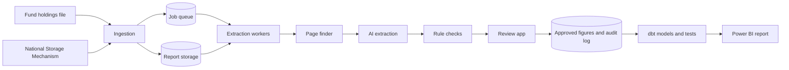

# Carbon Receipts

Carbon figures for UK listed companies, and for the funds that hold them, where every number comes with a receipt: the report, page and quoted text it came from.

> **Status: in development.** Nothing runs yet. I start building on 12 October 2026 in weekly sprints, and I'm aiming to have the main version public by the end of November 2026. The full plan is in the [problem specification](docs/problem-spec.pdf).

## Why

UK listed companies have had to publish their Scope 1 and Scope 2 greenhouse gas emissions in their annual reports since 2019. Funds, including the pensions and index trackers a lot of people invest through, add these figures up into carbon metrics for the whole portfolio.

Checking any of those numbers is hard. The emissions sit somewhere in a 200-page PDF, in a table, a chart or a paragraph, and where they sit changes from company to company and year to year. Fund-level figures usually come from commercial data providers, who fill gaps with modelled estimates, and nothing links a figure back to the page it came from.

I want to be able to see what's behind a company's or a fund's carbon figure, and how much of it comes from what the companies reported rather than from estimates. Carbon Receipts is a free, open pipeline for doing that.

## How it will work

1. You choose the companies, either by entering names or tickers or by loading a fund's published list of holdings.
2. The pipeline fetches each company's latest annual report from the FCA's [National Storage Mechanism](https://www.fca.org.uk/markets/primary-markets/regulatory-disclosures/national-storage-mechanism), the official free store of UK listed company filings.
3. It ranks the pages most likely to hold emissions and revenue, so only a handful go to the AI model.
4. The AI model returns the figures as structured data. Each figure keeps its receipt: the document, the page and the quoted text.
5. Rules flag wrong units, implausible values, totals that don't add up and big jumps from the year before.
6. A person approves, corrects or rejects each figure while looking at an image of its source page. Every decision goes into an audit log.
7. Approved figures go into a data warehouse. A Power BI report lets you go from a fund's figure to a company, and from there to the page its number came from.

## What it measures

All emissions are in tonnes of CO2 equivalent (tCO2e).

For each company, from its annual report:

- Scope 1, the direct emissions from things the company owns or controls, such as the fuel it burns and its industrial processes
- Scope 2, the emissions from the electricity and heat it buys, kept separate for each method the company reports (location-based or market-based)
- the Scope 3 total, if the company gives one
- revenue, energy use and the reporting period, for this year and last
- carbon intensity, which is emissions per million of revenue

For a fund, from its holdings:

- carbon intensity, which is each company's carbon intensity averaged by how much of the fund it makes up
- coverage, the share of the fund by value that has reported figures behind it. Where a figure is missing, the report shows a gap instead of an estimate.
- financed emissions and carbon footprint, where enterprise value is available. These are the fund's share of each company's emissions, and those emissions per million invested.

I'll measure extraction accuracy against a set of at least 30 reports I've checked by hand, and publish the result here, whatever it turns out to be.

## Scope

The first version covers UK listed companies. I'm testing it on the holdings of a FTSE 100 tracker and one other UK equity fund. It won't estimate emissions for companies that don't report them, break Scope 3 down by category, handle reports from outside the UK, or give investment advice.

## Tech stack

- Python 3.12, managed with uv, for ingestion, PDF processing and extraction
- pypdfium2 and pdfplumber for page text and images
- BM25 keyword search and fastembed embeddings to find the right pages, which works without a GPU
- the Gemini API on its free tier, with Pydantic checking its output
- SQL Server 2025 Express on the laptop and Azure SQL Database in the cloud, plus Azure Blob Storage for the reports
- dbt Core for the warehouse models and tests
- Streamlit for the review app
- Power BI for the report
- pytest, ruff and GitHub Actions for tests and CI

Everything runs on free tiers, and the whole pipeline should run on an ordinary Windows laptop with 8 GB of RAM and no GPU.

## Roadmap

| Sprint | Dates | Stories |
|--------|-------|---------|
| 1 | 12 to 18 Oct | Repo, CI and database setup, choosing companies, matching reports (US1 to US4) |
| 2 | 19 to 25 Oct | Report storage, job queue, PDF processing, evaluation set (US5 to US8) |
| 3 | 26 Oct to 1 Nov | Page finder, AI extraction, receipts (US9 to US11) |
| 4 | 2 to 8 Nov | Rule checks, audit log, revenue cross-check, second fund (US12, US13, US21, US22) |
| 5 | 9 to 15 Nov | Review app, warehouse models, company and fund metrics (US14 to US16) |
| 6 | 16 to 22 Nov | Power BI report, accuracy, carbon footprint, CSV export (US17, US18, US23, US24) |
| 7 | 23 to 29 Nov | Docs and Azure deployment (US19, US20) |

Once the main version is out, I'll add plain-English questions over the approved figures (US25). After that comes a comparison with [Climate TRACE](https://www.climatetrace.org/data)'s independent estimates (US26) and a Microsoft Fabric deployment (US27).

## Getting started

I'll add setup instructions as I build the pipeline. Report PDFs, downloaded data and API keys never go into the repo. Keys live in a local `.env` file.

## Licence

The code is under the [MIT Licence](LICENSE). The annual reports belong to the companies that publish them, so they aren't in this repo, and the outputs only hold links, page numbers and short quotes.

## Author

Leo McGinn
